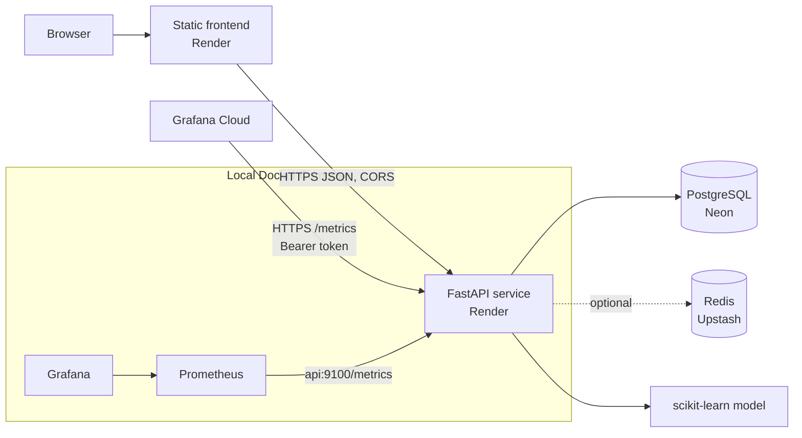

# Spam Detection API

A FastAPI service that classifies short text messages as **spam** or **ham** with a scikit-learn Naive Bayes model. It includes account authentication, revocable API keys, prediction caching, rate limits, and Prometheus metrics.

- **Live demo:** [spam-detection-api-frontend.onrender.com](https://spam-detection-api-frontend.onrender.com)
- **API:** [spam-detection-api-hpf8.onrender.com](https://spam-detection-api-hpf8.onrender.com) · [Health](https://spam-detection-api-hpf8.onrender.com/health) · [API docs](https://spam-detection-api-hpf8.onrender.com/docs)

## Features

- `/predict` classifies SMS-style text and returns a label and spam score.
- Users sign up and log in with passwords. Access tokens are JWTs; refresh tokens rotate and can be revoked.
- Prediction requests require an API key. Keys can be listed and revoked, and are shown only once when created.
- Redis optionally caches predictions and tracks rate limits. The API continues without Redis, but skips caching and rate limits when Redis is unavailable.
- Prometheus metrics cover HTTP requests, predictions, cache outcomes, model inference, and rate limiting.
- The demo frontend is plain HTML, CSS, and JavaScript.

## Architecture



The API loads the trained model once at startup. A prediction request is checked against the IP and API-key rate limits, then Redis is checked for a cached result. On a cache miss, the model runs and the result is cached for one hour. User accounts, refresh-token sessions, and API keys are stored in PostgreSQL.

For hosted metrics scraping, the API also exposes `/metrics` on its public HTTP port. Set `METRICS_BEARER_TOKEN` on the API and provide the same token to Grafana Cloud. The separate metrics port is used by the local Compose Prometheus service.

## Deployment demo

The public demo is deployed as two Render services:

- **Frontend:** [https://spam-detection-api-frontend.onrender.com](https://spam-detection-api-frontend.onrender.com), a Render Static Site.
- **Backend:** [https://spam-detection-api-hpf8.onrender.com](https://spam-detection-api-hpf8.onrender.com), a Docker Web Service.
- **Database:** PostgreSQL hosted on Neon.
- **Redis:** Upstash Redis, optional.
- **Metrics:** Grafana Cloud can scrape the API's authenticated `/metrics` endpoint.

The frontend selects the deployed API URL automatically. The backend's `ALLOWED_ORIGINS` must contain the exact frontend origin, for example `https://spam-detection-api-frontend.onrender.com`.

## Local deployment

The current schema migration intentionally clears the `user`, `refresh_token`, and `api_key` tables when upgrading a database from the preceding revision. This removes all accounts, sessions, and API keys. Use a disposable development database for that upgrade; the deletion cannot be undone by downgrading.

### Docker Compose

Docker Compose starts the API, demo frontend, Redis, migration task, Prometheus, and Grafana. PostgreSQL must be available separately; the Compose file does not include a database container. Point it at a development database reachable from the containers, never a production database.

1. Copy the environment template and edit it:

   ```bash
   cp .env.example .env
   ```

2. Set `DATABASE_URI` to your development PostgreSQL connection string. Generate a JWT secret with `openssl rand -hex 32`, and choose a local `GRAFANA_ADMIN_PASSWORD`.
3. Start the services:

   ```bash
   docker compose up --build
   ```

4. Open the local services:

   | Service | URL |
   | --- | --- |
   | Demo frontend | http://localhost:8080 |
   | API | http://localhost:8000 |
   | API docs | http://localhost:8000/docs |
   | Prometheus | http://localhost:9090 |
   | Grafana | http://localhost:3000 |

The API image trains the model during its build and downloads the pinned public dataset. The `migrate` service applies pending database migrations before the API starts.

### Run the API directly

Use Python 3.13 and `uv`, plus a local PostgreSQL database. Redis is optional.

```bash
cp .env.example .env
# Set DATABASE_URI to the development database and JWT_SECRET to `openssl rand -hex 32`.
uv sync --group train
uv run alembic upgrade head
uv run python -m ml.train
uv run uvicorn app.main:app --reload
```

In another terminal, serve the frontend on an allowed local origin:

```bash
uv run python -m http.server 8080 --directory frontend
```

Open http://localhost:8080. For requests from a local browser, make sure `ALLOWED_ORIGINS` in `.env` includes `http://localhost:8080` and `http://127.0.0.1:8080`.

## API routes

| Method | Route | Purpose |
| --- | --- | --- |
| `GET` | `/health` | Liveness check |
| `GET` | `/ready` | Checks model startup and database connectivity |
| `POST` | `/auth/signup` | Create an account |
| `POST` | `/auth/login` | Log in and receive access and refresh tokens |
| `POST` | `/auth/refresh` | Rotate a refresh token |
| `GET` | `/auth/me` | Return the logged-in account |
| `GET` | `/auth/api-keys` | List API keys |
| `POST` | `/auth/api-keys` | Create an API key |
| `DELETE` | `/auth/api-keys/{key_id}` | Revoke an API key |
| `POST` | `/auth/logout`, `/auth/logout-all` | Revoke one refresh-token family or all user sessions |
| `POST` | `/predict` | Classify text; requires `X-API-Key` |
| `GET` | `/metrics` | Prometheus metrics; optional Bearer protection via `METRICS_BEARER_TOKEN` |

Example prediction:

```bash
curl -X POST https://spam-detection-api-hpf8.onrender.com/predict \
  -H 'Content-Type: application/json' \
  -H 'X-API-Key: YOUR_API_KEY' \
  -d '{"text":"WINNER! Claim your free prize now"}'
```

Example response:

```json
{"label":"spam","spam_probability":0.99,"from_cache":false}
```

## Configuration

Copy `.env.example` to `.env` for local use. Keep `.env` and production secrets out of Git.

| Variable | Purpose |
| --- | --- |
| `DATABASE_URI` | Async SQLAlchemy PostgreSQL URL |
| `JWT_SECRET` | Secret used to sign access tokens; at least 32 characters |
| `ACCESS_TOKEN_EXPIRES_MINUTES` | Access-token lifetime |
| `REFRESH_TOKEN_EXPIRE_DAYS` | Refresh-token lifetime |
| `ALLOWED_ORIGINS` | JSON array of browser origins permitted by CORS |
| `REDIS_URL` | Optional cache and rate-limit Redis URL |
| `SPAM_THRESHOLD` | Probability cutoff for the spam label; default `0.5` |
| `METRICS_BEARER_TOKEN` | Optional bearer token protecting the public metrics route |
| `GRAFANA_ADMIN_PASSWORD` | Local Grafana password for Docker Compose |

## Model and development

The model is a Bernoulli Naive Bayes classifier trained on the UCI SMS Spam Collection. Training uses a pinned dataset version and fails if held-out F1 is below 0.90. The reported held-out F1 is 0.949; `spam_probability` is a model score and is not calibrated as a confidence percentage.

```bash
uv sync --group train
uv run pytest
uv run ruff check .
```
